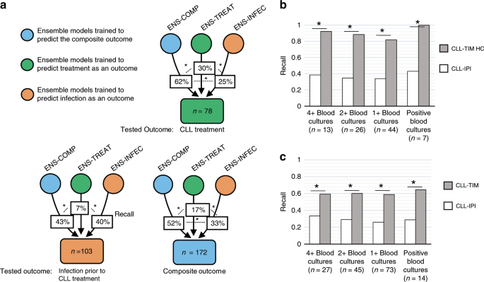
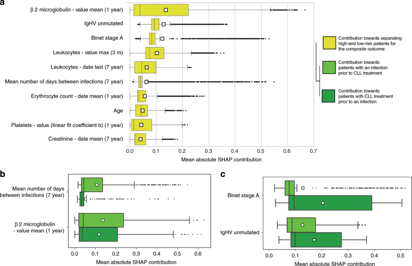
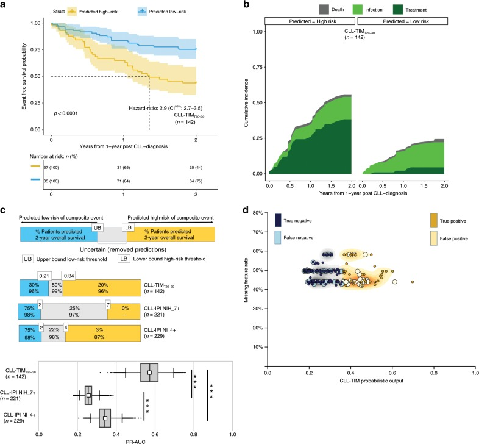

# CLL-TIM — CLL Treatment–Infection Model

> A machine-learning model used for patient selection in a randomized clinical trial,
> deployed as a stand-alone service inside Denmark's Epic-based EHR (*Sundhedsplatformen*, ~2.5M citizens).

[](https://doi.org/10.1038/s41467-019-14225-8)
[](https://doi.org/10.1038/s41746-024-01132-6)
[](https://clinicaltrials.gov/study/NCT03868722)
[]()

**Rudi Agius** — Rigshospitalet, Copenhagen University Hospital / DTU

---

## Purpose

Infections are the major cause of morbidity and mortality in chronic lymphocytic
leukaemia (CLL) due to immune dysfunction and cytotoxic treatment. CLL-TIM predicts
the **2-year risk of the composite outcome "infection or CLL treatment"** from a
prediction point after diagnosis, so that high-risk patients can be enrolled for
early intervention (PreVent-ACaLL trial, NCT03868722 — seven hospitals across
Denmark, Sweden and the Netherlands).

For each patient the model returns three things:

1. **Risk** — probability of the composite outcome within 2 years
2. **Confidence** — how certain CLL-TIM is about *that specific patient*
3. **Personalized risk factors** — the top feature contributions driving the
   patient's score, via SHAP values

Example report — the three outputs in one view (synthetic patient; see
*How to run* below):


*Risk gauge and confidence band up top; the top personalized risk factors —
here high β2-microglobulin, infection history and unmutated IGHV drive the
score up, offset by favourable markers — underneath.*

## The ethos: why an ensemble

Clinical data is heterogeneous, noisy and missing by default. No single
algorithm sees all of it well — a linear model finds monotone risk trends,
trees find interactions and threshold effects, and each fails on different
patients. The ensemble bet is classical: combining base-learners whose
*errors are uncorrelated* reduces the overall error as the ensemble grows,
and reduces overfitting to any one view of the data.

CLL-TIM's development pipeline was built around that principle — diversity
first, then select the ensemble that should generalize best:


*Patient histories were modelled in three look-back windows (3 months, 1 year,
7 years) up to a prediction point 3 months post-diagnosis, producing a
7,288-dimensional feature space. 2,000 candidate base-learners were trained;
a genetic algorithm assembled 29 ensembles of 2–30 learners, which were
ranked for expected generalization — the top-ranked ensemble became CLL-TIM.*
*(Agius et al., Nat Commun 2020, Fig. 1 — CC-BY 4.0)*

### How diversity was ensured

- **Three different prediction tasks.** Of the 2,000 learners trained, 1,000
  targeted the composite outcome, 500 CLL treatment, and 500 infection as a
  first event — the same patient, read through three different clinical
  questions. The final ensemble keeps all three: 20 composite, 5 treatment,
  3 infection learners.
- **Seven algorithm families.** Learners were drawn from KNN, logistic
  regression, elastic-net, perceptron, random forest, extra trees and
  XGBoost — linear and non-linear inductive biases. Learners scoring below
  the population-mean MCC were dropped before selection.
- **Different data views.** Each learner received its own feature subset and
  encoding mix (bag-of-words event frequencies, lab-test date models, lab
  value models, look-back windows). Only ~2% of pairwise feature
  correlations across the ensemble exceed |PCC| > 0.8.


*The 28 selected base-learners, the variables each one uses (columns are
learners; colour encodes data category and training outcome), and the feature
encodings each was built on. Deliberately partial overlap is the diversity
mechanism.* (Agius et al., Nat Commun 2020, Fig. 2 — CC-BY 4.0)

### Selecting and ranking the ensemble

Picking the ensemble with the best validation score would overfit the
validation set. Instead, the 29 candidate ensembles were ranked by a
composite of **six criteria** — validation performance plus predictive and
compositional dissimilarity between the member learners — and the apex
ensemble was taken forward to untouched internal and external test cohorts.



*Recall for the composite outcome as a function of ensemble size across the
29 GA-generated ensembles (2–30 base-learners), and the benefit of modelling
infection and CLL treatment jointly rather than separately — the composite
outcome outperforms either single-outcome formulation.*
(Agius et al., Nat Commun 2020, Fig. 6 — CC-BY 4.0)

## How a patient is scored

The shipped ensemble is 28 serialized learners (`CLLTIMData/CLL-TIM_BLN_*.sav`):

| Learner | Count |
|---|---|
| XGBoost (`XGBClassifier`) | 13 |
| Random Forest | 7 |
| Extra Trees | 4 |
| Elastic-net linear (`SGDClassifier`, log loss) | 2 |
| Logistic Regression | 2 |

Each learner consumes its own feature subset of the 228-feature vector —
85 original variables engineered across the three look-back windows — with
its own fitted imputation values and scaler stored in the model pack
(`vecgetcolmean.pkl`, `vec_scaler.pkl`). XGBoost learners consume raw values
and handle NaN natively. Learner probabilities are min–max normalized with
stored per-learner vectors (`vec_mn_all.pkl`, `vec_mx_all.pkl`) and averaged:

$$\hat{p} = \frac{1}{28}\sum_{i=1}^{28} f_i(\mathbf{x}_i)$$

All 28 votes on the bundled synthetic patients — colour = algorithm family,
solid marker = the learner's training outcome, dashed line = ensemble mean.
The spread of votes around the mean is exactly the disagreement the
confidence flag is built on:


*Generated by `examples/clltim_showcase.py` on the bundled synthetic patients —
an illustration of the scoring mechanics and of how differently the five
algorithm families vote on the same patient, not a performance figure.*

**Personalized risk factors** sum each learner's SHAP attribution back onto
the 228-feature axis ($\Phi_j = \sum_i \phi_j^{(i)}$) and rank by $|\Phi_j|$.
Aggregated across patients, the top drivers recover the known CLL prognostic
biology — del17p, β2-microglobulin, IGHV/ZAP70 status, prior infections,
leukocyte/neutrophil dynamics, age:



*Top risk factors for the composite outcome, and factors specific to
infection-first and treatment-first events (mean |SHAP| across learners).*
(Agius et al., Nat Commun 2020, Fig. 7 — CC-BY 4.0)

## The fail-safe: confidence as a product feature

CLL-TIM does not just emit a number — it tells you when not to trust it. The
magnitude of agreement between the 28 base-learners is used as an uncertainty
estimate, computed without any knowledge of ground truth. In the deployed
build this becomes a calibrated band rule on the ensemble risk:

$$\text{High-Confidence} \iff \hat{p} \ge 0.58 \;\lor\; \hat{p} < 0.28$$

Scores in the 0.28–0.58 band — near the decision boundary — are flagged
Low-Confidence on the report. This implements the same *T20–30* selective-
prediction logic validated in the paper (keep the top-20% high-risk and
bottom-30% low-risk calls; withhold judgement on the middle).


*On the internal test cohort, high-confidence predictions carried a hazard
ratio of 7.3 vs 2.1 for low-confidence — the confidence flag is a real
accuracy signal, not decoration: 2-year event-free survival 27.8% vs 83.5%
for HC high-/low-risk groups, at precision 0.72 / recall 0.75 / MCC 0.56,
outperforming the CLL-IPI gold standard.*
(Agius et al., Nat Commun 2020, Fig. 3 — CC-BY 4.0)

## Robustness to missing data

Real EHR data is never complete, and CLL-TIM was designed to score every
patient anyway — patients with full CLL-IPI variables made up less than half
of the development cohort. Missingness is handled at three stacked layers:


*(i) **Feature level** — missingness itself is encoded as features
(one-hot missing indicators; lab-test-date models capture the *recentness or
absence* of tests, which is itself clinical signal). (ii) **Algorithm level** —
XGBoost learners natively split on missing values; other learners use
imputation fitted on the training data. (iii) **Ensemble level** — each
learner sees a different bagged feature subset, so a missing variable only
degrades the subset of learners that depend on it.*
(Agius et al., npj Digit Med 2024, Fig. 6 — CC-BY 4.0)

The practical consequence: predictions hold up across the missingness
spectrum seen in deployment EHR —


*Performance of CLL-TIM as a function of each patient's missing-feature rate
on the deployment cohort — accuracy degrades gracefully rather than failing
at a threshold.* (Agius et al., npj Digit Med 2024, Fig. 7 — CC-BY 4.0)

and on the heavily-incomplete external German CLL7 cohort the model still
separated high- from low-risk patients where CLL-IPI could not score the
majority:



*Kaplan–Meier and cumulative-incidence analyses on the external test cohort
under substantial missing data; PR-AUC benchmark against CLL-IPI variants.*
(Agius et al., Nat Commun 2020, Fig. 4 — CC-BY 4.0)

## Multiple pathways towards risk

Personalized risk factors matter because there is no single route to a
high-risk CLL patient. Two patients with the same score can arrive there
through entirely different biology — one via prior infections and β2M,
another via cytogenetics and IGHV status. The paper's analysis shows
CLL-TIM's predictions decompose into distinct, patient-specific pathways:


*Input interface and personalized factor breakdown: the same ensemble risk
can be driven by different factor combinations per patient — which is also
why the ensemble is robust: no single pathway dominates the vote.*
(Agius et al., Nat Commun 2020, Fig. 9 — CC-BY 4.0)

## Validation beyond development

**Prospective trial validation — PreVent-ACaLL non-randomized cohort**
(EHA 2026, abstract S143): the first prospective, multicentre validation of
CLL-TIM, run inside the phase 2 trial across nine international sites.
574 patients were stratified into the four risk/confidence groups and
followed for 2 years:

| Group | Share | 2-y infection-/treatment-free |
|---|---|---|
| High-risk, high-confidence | 17% | **54%** |
| High-risk, low-confidence | — | 74.7% |
| Low-risk, low-confidence | — | 90.3% |
| Low-risk, high-confidence | — | 95.9% |

The confidence flag calibrated prospectively — HR-HC patients did
significantly worse than both the low-risk groups *and* the HR-LC group —
and HR-HC patients also showed lower 2-year overall survival (88.7%),
despite the model never being trained on survival.

**Independent US validation — Mayo Clinic** (AACR 2026, Cancer Res abstract
4228): first validation on a US cohort — 454 newly diagnosed CLL patients
(2000–2020, Rochester Epidemiology Project), endpoints replicated
including the same blood-culture-drawn infection proxy. On the 2-year
composite endpoint (21% event rate):

| Model | ROC-AUC (composite) | TTFT | Infection |
|---|---|---|---|
| **CLL-TIM** | **0.74** (0.68–0.80) | **0.79** | **0.68** |
| CLL-IPI | 0.69 (0.63–0.75) | 0.74 | 0.57 |
| IPS-E | 0.68 (0.62–0.74) | 0.76 | 0.52 |

CLL-TIM reproduced its published discrimination exactly (AUC 0.74, same as
in the original paper), exceeded the AUC > 0.7 threshold for individual-level
prediction, and significantly outperformed IPS-E (p = 0.02). For the
composite endpoint its advantage over CLL-IPI was not statistically
significant (p = 0.11) — honest external evidence: the model transports
across populations and EHR systems, with the largest margins where
infection is the endpoint (0.68 vs 0.57/0.52).

## How to run

### 1. Install

```bash
conda env create -f environment-pipxgboost.yml   # see note below
conda activate clltim_calc_env
```

> **Install note.** The shipped `environment.yml` pins `xgboost=0.82` from the
> `defaults` channel, which Anaconda has since removed.
> `environment-pipxgboost.yml` is an identical spec with xgboost installed
> via pip instead — use it on current conda releases. If you see a crash
> inside `PyPDF2/utils.py` while warnings are being formatted, run with
> `PYTHONWARNINGS=ignore` (a PyPDF2-1.26 warning-hook quirk; it does not
> affect predictions).

### 2. Prepare a patient file

Patient files are long-format CSVs — one row per observation, patients
concatenated in a single file:

```csv
Patient,Diag_Date,Prediction_Point,Variable_Category,Variable_Name,Date_of_Test,Value_of_Test,Units_of_Test
TestPat01,2018-02-22,2018-05-10,lab,b2m,2018-04-19,5.7,mg_L
TestPat01,2018-02-22,2018-05-10,ii,infec,2017-06-18,0,na
TestPat01,2018-02-22,2018-05-10,baseline,ighv,na,unmu,na
```

The data dictionary is `PatientFileFormat.xlsx` (variable categories:
`lab`, `ii` infection indicators, `baseline` CLL-specific markers,
`patho`, `diag`), with per-feature definitions in
`CLLTIMData/FeatureFunctionalNames.csv`. `PatientFiles/SynthPat_Multi.csv`
is a ready-made example holding nine concatenated synthetic patients.

### 3. Score

```bash
python CLLTIM_MobileVer2.py    # reads PatientFiles/SynthPat_Multi.csv
                               # writes reports into ./CLLTIMOutput/
```

### 4. Sanity check

```bash
python examples/verify_install.py
```

A correct install produces, for every patient in the file, the same set of
six outputs — `<Pat>.pdf/.png`, `<Pat>HeatmapsTop.pdf/.png`,
`<Pat>_Report.pdf`, `<Pat>_RiskFactors.txt` — plus the two aggregate CSVs
`SynthPat_Multi_Outputs_FeatureVectors.csv` and
`SynthPat_Multi_Outputs_RiskFactors.csv`. The script runs the app, checks
that set per patient, and compares the deterministic outputs against the
reference copies in `docs/synthetic_patient_examples/`.

## Reading the output — practical notes

- **Focus on High-Confidence predictions.** The HC flag is the model's own
  triage: HC calls were ~3.5× more accurate than LC calls on test data
  (HR 7.3 vs 2.1). A Low-Confidence result is CLL-TIM saying the evidence
  is borderline — treat it as "insufficient signal", not as a risk score.
- **"Infection" means a blood culture was drawn.** Because a culture is
  drawn in standard practice when symptoms suggest serious infection, the
  draw *event* is the proxy — regardless of whether the culture came back
  positive, negative or contaminated.
- **Run it some time after diagnosis.** The prediction point sits ~3 months
  post-diagnosis (the `Prediction_Point` column); patients who were treated
  or died before it were outside the model's intended use.
- **Feed it history.** Scores are built from 3-month / 1-year / 7-year
  look-back windows of laboratory data and blood cultures — the model is
  only as good as what you feed it. A patient file with sparse history will
  still be scored (missingness layers), but rich longitudinal data is what
  makes the predictions sharp.

## Repository layout

| Path | Contents |
|---|---|
| `CLLTIM_MobileVer1.py`, `CLLTIM_MobileVer2.py` | Stand-alone scoring application (v2 = deployed mobile/trial version, 30-09-2025). Unmodified. |
| `CLLTIMData/` | Trained ensemble (`*_BLN_*.sav`), feature matrices & names (`*.npy`), fitted scalers/imputers/kmeans (`*.pkl`), feature dictionaries (`*.csv`) |
| `PatientFiles/SynthPat_Multi.csv` | Nine synthetic patients concatenated — the sanity-check input |
| `PatientFileFormat.xlsx` | Patient-file schema / data dictionary |
| `CLLTIMOutput/` | Reports are written here (gitignored) |
| `pipeline_scripts/` | Research pipeline: feature engineering (`FeatureProcessing.py`, `RollingFeatures.py`, `FeatEncV3.py`, `data_proc_funcs.py`), data prep (`DT_Data_Prepare.py`, `DataGenny.py`), ICD-10 cleaning (`MedDiagCleaning.py`) |
| `examples/verify_install.py` | Sanity check — runs the app and confirms the expected output set per patient |
| `examples/clltim_showcase.py` | Internal analysis script — replays the per-learner inference path (votes figure above) |
| `docs/synthetic_patient_examples/` | Reference output set for the bundled patients |
| `docs/figures/paper/` | Published figures (© the authors, CC-BY 4.0 — see captions) |
| `docs/papers/` | The two main papers + supplementary information (PDF, CC-BY 4.0) |
| `docs/demo_videos/` | `Patient01.mp4`, `Patient02.mp4` — application demos |
| `docs/talks/` | `CambridgeSummerSchoolTalk.pptx` — "Working With Clinical Data" (guest lecture) |

## Publications

- **Model** — Agius R., et al. *Machine learning can identify newly diagnosed
  patients with CLL at high risk of infection.* **Nature Communications** 11, 363 (2020).
  [doi:10.1038/s41467-019-14225-8](https://doi.org/10.1038/s41467-019-14225-8)
- **Deployment** — Agius R., et al. *Deployment and validation of the CLL
  treatment infection model adjoined to an EHR system.* **npj Digital Medicine**
  7, 147 (2024). [doi:10.1038/s41746-024-01132-6](https://doi.org/10.1038/s41746-024-01132-6)
- **Recommendations** — Agius R., et al. *Artificial intelligence models in
  chronic lymphocytic leukemia – recommendations toward state-of-the-art.*
  **Leukemia & Lymphoma** 63(2) (2022).
  [doi:10.1080/10428194.2021.1973672](https://doi.org/10.1080/10428194.2021.1973672)
- **Prospective validation** — Agius R., da Cunha-Bang C., Katsimigas A., et
  al. (incl. Niemann C.U.) *Prospective validation of the CLL-TIM
  machine-learning algorithm predicting infection and treatment in CLL:
  results from the phase 2 clinical trial PreVent-ACaLL, non-randomized
  cohort.* **EHA Congress 2026**, abstract S143.
  [library.ehaweb.org](https://library.ehaweb.org/eha/2026/eha-2026/4206697/carsten.utoft.niemann.prospective.validation.of.the.cll-tim.machine-learning.html)
- **US external validation** — Mwangi R., Shanafelt T.D., …, Parikh S.A.
  *Validation of the CLL treatment infection model (CLL-TIM) in patients
  with newly diagnosed chronic lymphocytic leukemia (CLL).* **Cancer
  Research** 86(7_Supplement): 4228 (AACR 2026).
  [doi:10.1158/1538-7445.AM2026-4228](https://doi.org/10.1158/1538-7445.am2026-4228)
- **Trial** — [PreVent-ACaLL, NCT03868722](https://clinicaltrials.gov/study/NCT03868722)

## Notes

- All patients in this repository are **synthetic**; no real patient data is
  included, and outputs on them are illustrative of the tool's mechanics,
  not performance results — for those see the papers.
- Source code is preserved **as-released** for archival fidelity; quirks are
  handled via the environment, not code edits.
