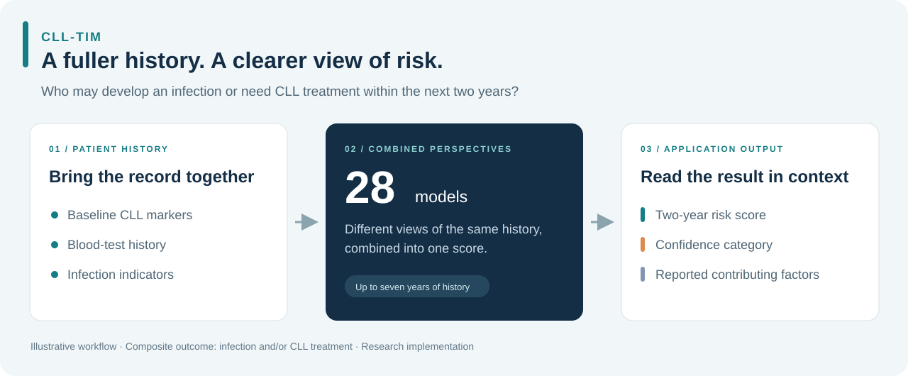
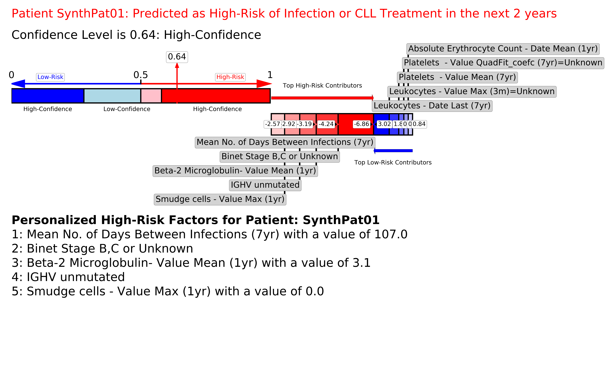

# CLL-TIM

### Using patient history to assess the risk of infection or CLL treatment

CLL-TIM—the **Chronic Lymphocytic Leukaemia Treatment–Infection Model**—is a machine-learning model for people newly diagnosed with CLL, a blood cancer. It addresses a practical question: **who may develop an infection or need CLL treatment within the next two years?**

It combines clinical markers, blood-test histories and infection indicators to return a risk score, a confidence category and patient-specific contributing factors. CLL-TIM has been evaluated in Denmark and Germany, used for patient selection in an international clinical trial, and deployed alongside an Epic-based Danish electronic health record.

[Overview](#why-cll-tim) · [Evidence](#where-it-has-been-evaluated-and-used) · [Try it](#try-the-synthetic-example) · [Input guide](docs/USAGE.md) · [Technical details](docs/METHODS.md)



## Why CLL-TIM?

Infections are an important cause of illness and death in CLL. CLL-TIM was developed to identify increased risk early, including in people who do not yet need treatment under standard clinical criteria. Its use for trial selection lets researchers investigate whether pre-emptive treatment can improve outcomes.

The model uses patterns across a patient's history, including repeated blood tests and prior infection indicators. Its 28 component models combine different views of those data. It can process incomplete records, although the information available still affects its predictions.

## What it returns

| Output | What it tells you |
|---|---|
| **Risk score** | A score for infection and/or CLL treatment within two years of the prediction point. |
| **Confidence category** | High or low confidence, derived from thresholds on the combined score. |
| **Contributing factors** | Features the application reports as contributing towards higher or lower risk for that patient. |

The outcome combines infection and CLL treatment; the application does not return two separate clinical probabilities. In the original study, **having a blood culture drawn** was the infection indicator, regardless of the result. The development prediction point was three months after diagnosis, with the two-year outcome window beginning at that point. See [outcome definitions and study populations](docs/EVIDENCE.md).

## Where it has been evaluated and used

| Stage | Setting | Evidence |
|---|---|---|
| **Development and validation · 2020** | Denmark; external German CLL7 cohort | Retrospective development and held-out evaluation, followed by external validation. [Nature Communications](https://doi.org/10.1038/s41467-019-14225-8) |
| **EHR deployment · 2024** | Rigshospitalet and Roskilde, Denmark | Automated predictions adjoining an Epic-based EHR, with retrospective evaluation on a later patient cohort. [npj Digital Medicine](https://doi.org/10.1038/s41746-024-01132-6) |
| **Trial application** | International PreVent-ACaLL trial | Selection of high-risk/high-confidence participants for a trial of pre-emptive treatment. [NCT03868722](https://clinicaltrials.gov/study/NCT03868722) |
| **Prospective follow-up · 2026** | Nine international trial sites | Non-randomized follow-up reported at EHA. **Conference abstract.** [Study details](docs/EVIDENCE.md#prospective-follow-up--eha-2026) |
| **US external evaluation · 2026** | Rochester Epidemiology Project, 454 patients | External validation reported at AACR. **Conference abstract.** [Study details](docs/EVIDENCE.md#us-external-evaluation--aacr-2026) |

The original study reported **72% precision and 75% recall on a selected high-confidence internal benchmark subset**. These are not overall accuracy estimates. The [evidence guide](docs/EVIDENCE.md) gives cohort sizes, selection rules, comparisons and limitations. Prediction validation and trial selection do not by themselves establish a benefit from early treatment.

## Try the synthetic example

**[Open a complete patient report](docs/synthetic_patient_examples/SynthPat01_Report.pdf)** to see the application before installing it. All nine example patients are synthetic; their results illustrate the software rather than clinical performance.

[](docs/synthetic_patient_examples/SynthPat01_Report.pdf)

*Original application output. The explanation implementation has [documented class-direction and scale limitations](docs/IMPLEMENTATION.md#feature-explanations).*

From a terminal with Git and Conda available:

```sh
git clone https://github.com/RA19/cll-tim.git
cd cll-tim
conda env create -f environment-pipxgboost.yml
conda activate clltim_calc_env
python examples/verify_install.py
```

The verifier runs all nine synthetic patients with fresh outputs and compares their text and CSV results against the bundled references. After a successful check, it copies **56 generated files** into `CLLTIMOutput/`, including the merged patient PDFs and two aggregate CSVs.

To run the application directly:

```sh
python CLLTIM_MobileVer2.py
```

The legacy runtime has been checked on Windows with Python 3.7.9 and the pinned libraries. A fresh installation on every platform has not been established. See [installation, troubleshooting and expected outputs](docs/USAGE.md).

## Use your own formatted data

The standalone v2 application reads a long-format CSV: one row per observation, with the patient identifier repeated across that patient's rows. One file can contain several patients. It processes baseline markers, laboratory results and infection indicators.

Use the [input guide](docs/USAGE.md#patient-file-format), [data dictionary](PatientFileFormat.xlsx) and [complete synthetic CSV](PatientFiles/SynthPat_Multi.csv). Put your CSV in `PatientFiles/`, change `PatientFileName` near the top of `CLLTIM_MobileVer2.py`, then run from the repository root.

## Explore further

| Guide | Contents |
|---|---|
| [Using CLL-TIM](docs/USAGE.md) | Installation, input format, report interpretation and troubleshooting |
| [Evidence](docs/EVIDENCE.md) | Validation cohorts, metrics, trial application and published result figures |
| [Methods](docs/METHODS.md) | Ensemble design, feature engineering, confidence and missing data |
| [Implementation](docs/IMPLEMENTATION.md) | Repository contents, version provenance, reproducibility and known limitations |
| [Figure sources](docs/figures/SOURCES.md) | Exact figure identities, captions and attribution |

This repository contains the standalone/mobile research implementation, trained model assets and synthetic examples. The original EHR deployment labeled predictions **research-use only**. The scoring applications and model files are preserved; this is not a complete training-reproduction package.

**Rudi Agius and collaborators** · Rigshospitalet / Copenhagen University Hospital · Technical University of Denmark. Full publications and author lists are linked in the [evidence guide](docs/EVIDENCE.md#publications).
