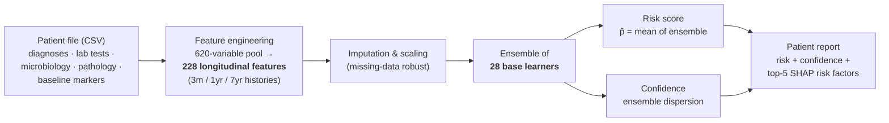
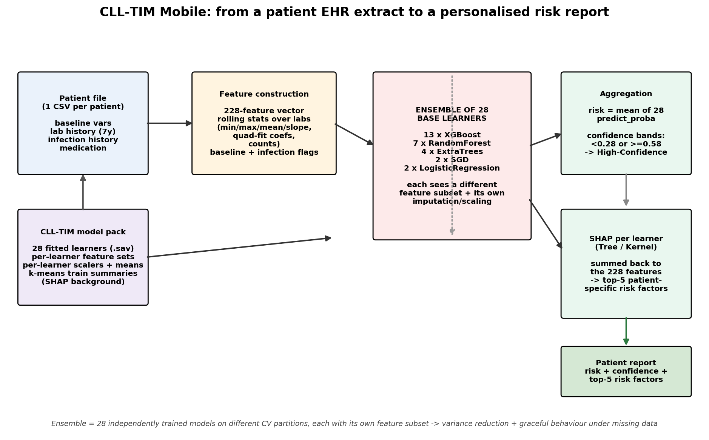
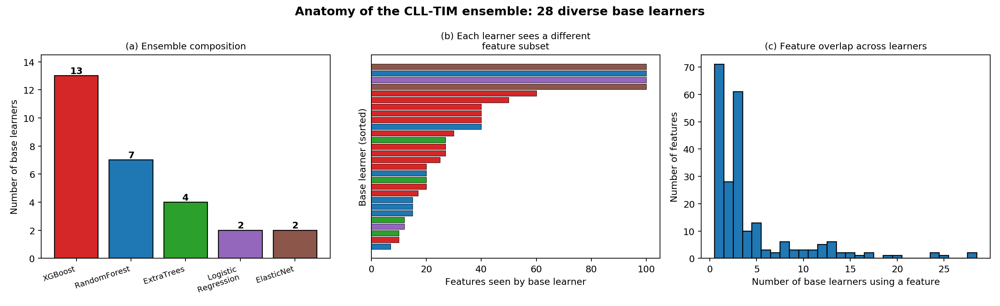
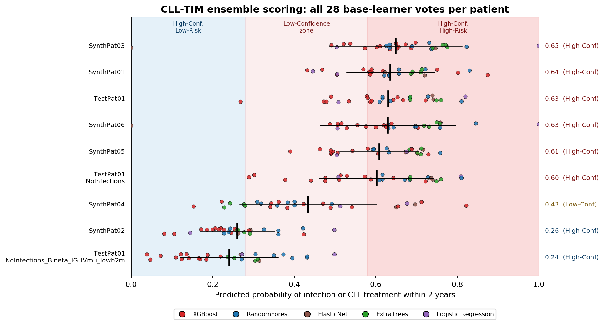
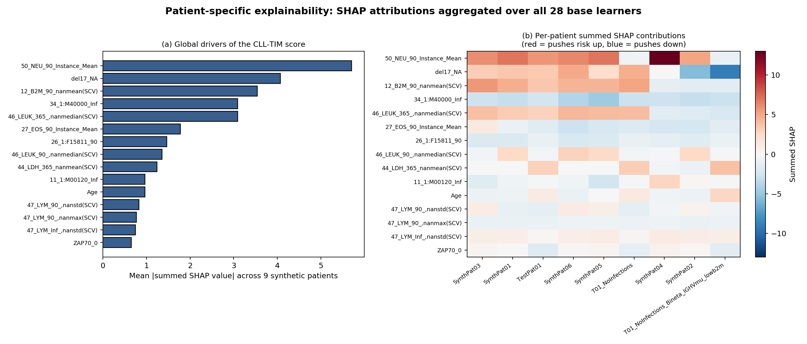
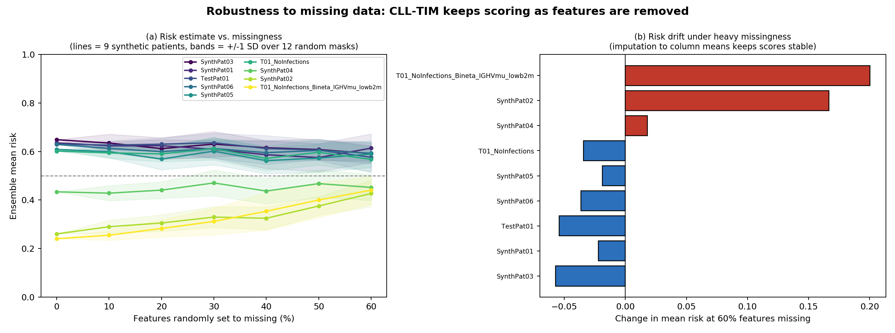

# CLL-TIM — CLL Treatment–Infection Model

> The first machine-learning model used for patient selection in a randomized clinical trial,
> deployed as a stand-alone service inside Denmark's Epic-based EHR (*Sundhedsplatformen*, ~2.5M citizens).

[](https://doi.org/10.1038/s41467-019-14225-8)
[](https://doi.org/10.1038/s41746-024-01132-6)
[](https://clinicaltrials.gov/study/NCT03868722)
[]()

**Rudi Agius** — Rigshospitalet, Copenhagen University Hospital / DTU · 2017–present

---

## Purpose

Infections are the major cause of morbidity and mortality in chronic lymphocytic
leukaemia (CLL) due to immune dysfunction and cytotoxic treatment. CLL-TIM predicts,
at the time of diagnosis, the **2-year risk of the composite outcome "infection or
CLL treatment"**, so that high-risk patients can be enrolled for early intervention
(PreVent-ACaLL trial, NCT03868722 — seven hospitals across Denmark, Sweden and
the Netherlands).

For each patient the model returns three things:

1. **Risk** — probability of the composite outcome within 2 years (High-/Low-Risk)
2. **Confidence** — how sure CLL-TIM is about *that specific patient*
3. **Personalized risk factors** — the top-5 feature contributions driving the
   patient's score, via SHAP values

## How it works



### The ensemble

Trained on **4,149 Danish CLL patients** with 7-year longitudinal EHR + registry
histories; validated on internal Danish and external German (CLL7) cohorts.
The 28 base learners shipped in this repository (`CLLTIMData/CLL-TIM_BLN_*.sav`):

| Learner | Count |
|---|---|
| XGBoost (`XGBClassifier`) | 13 |
| Random Forest | 7 |
| Extra Trees | 4 |
| Elastic-net linear (`SGDClassifier`, log loss) | 2 |
| Logistic Regression | 2 |

Each learner was trained on a different CV partition *and sees a different
feature subset* of the 228-feature vector, with its own fitted imputation
column-means and scaler (`vecgetcolmean.pkl`, `vec_scaler.pkl`).

Ensemble risk:

$$\hat{p} = \frac{1}{28}\sum_{i=1}^{28} f_i(\mathbf{x}_i)$$

where $\mathbf{x}_i$ is learner $i$'s own feature subset, imputed and scaled by
that learner's stored transforms (XGBoost learners consume raw values and handle
NaN natively — part of the missing-data robustness).

**Confidence** is a calibrated band rule on the ensemble risk, computed in
`CLLTIM_MobileVer2.py`:

$$\text{High-Confidence} \iff \hat{p} \ge 0.58 \;\lor\; \hat{p} < 0.28$$

— the same zones drawn on the patient report's confidence bar. Votes in the
0.28–0.58 zone flag the patient as *Low-Confidence* (near the decision
boundary), warning the clinician the estimate is marginal. Personalized risk
factors sum each learner's SHAP attribution back onto the 228-feature axis
($\Phi_j = \sum_i \phi_j^{(i)}$) and rank by $|\Phi_j|$.

### Key results (Nature Communications, 2020)

| Metric | Value |
|---|---|
| Precision (high-risk class) | **72%** |
| Recall | **75%** |
| Coverage under real-world missingness | **100%** of patients scored (vs ~3% for CLL-IPI) |
| High-confidence predictions | Hazard ratio ~7–8 (low-confidence ~2–3) |
| Benchmark | Outperforms CLL-IPI gold standard on internal + external cohorts |

## Verified working

The application **runs unmodified** today on synthetic patients and reproduces the
reference outputs **byte-for-byte** (see `docs/synthetic_patient_examples/` vs a
fresh run into `CLLTIMOutput/`).

**Example output** — generated by `CLLTIM_MobileVer2.py` on `SynthPat_Multi.csv`:


*Patient report: risk gauge (0.64, High-Confidence), top high-/low-risk SHAP
contributors, and the top-5 personalized risk factors.*

Run all six synthetic patients → 9 report sets + `SynthPat_Multi_Outputs_FeatureVectors.csv`
(228 features/patient) + `SynthPat_Multi_Outputs_RiskFactors.csv`.

## Showcase figures

Generated by `examples/clltim_showcase.py` — a **separate analysis script**
(the application itself is unmodified). It loads the same model pack, replays
the exact per-learner inference path on the golden synthetic patients, and
renders the ensemble's internals:

```bash
python examples/clltim_showcase.py            # all figures
python examples/clltim_showcase.py votes      # or a subset: anatomy,votes,shap,missingness,pipeline
```

**Pipeline** — from a patient EHR extract to the report:



**Ensemble anatomy** — 5 algorithm families, deliberately heterogeneous
feature subsets (5–100 features per learner), and partial feature overlap —
the diversity that makes the ensemble robust:



**Ensemble scoring** — every one of the 28 votes per patient (colour = model
family), mean marked; confidence zones shown:



**Explainability** — SHAP attributions aggregated over the 28 learners.
The top global drivers are the known CLL prognostic markers (del17p, β2M,
IGHV/ZAP70 status, infection-history ICD codes, leukocyte/neutrophil/lymphocyte
dynamics, age) — the heatmap shows *how they differ per patient*:



**Missing-data robustness** — features are progressively masked to NaN and the
patient is re-scored through the real inference path (mean-imputation for
non-XGBoost learners, native NaN handling for XGBoost). Scores hold near their
baseline to ~50% missing; at 60% they regress toward the cohort mean — the
expected, honest behaviour of mean-imputation:



Raw per-learner votes for the table above: `docs/figures/ensemble_votes.csv`.

## Repository layout

| Path | Contents |
|---|---|
| `CLLTIM_MobileVer1.py`, `CLLTIM_MobileVer2.py` | Stand-alone scoring application (v2 = deployed mobile/trial version, 30-09-2025). **Unmodified.** |
| `CLLTIMData/` | Trained ensemble (`*_BLN_*.sav`), feature matrices & names (`*.npy`), fitted scalers/imputers/kmeans (`*.pkl`), feature dictionaries (`*.csv`) |
| `PatientFiles/SynthPat_Multi.csv` | Synthetic patients (concatenate multiple rows/patients per file) |
| `PatientFileFormat.xlsx` | Patient-file schema |
| `CLLTIMOutput/` | Reports are written here |
| `pipeline_scripts/` | Research pipeline: feature engineering (`FeatureProcessing.py`, `RollingFeatures.py`, `FeatEncV3.py`, `data_proc_funcs.py`), data prep (`DT_Data_Prepare.py`, `DataGenny.py`), ICD-10 cleaning (`MedDiagCleaning.py`) |
| `docs/synthetic_patient_examples/` | Reference outputs (golden set used to verify the run) |
| `docs/figures/` | Showcase figures + `ensemble_votes.csv` (generated, see below) |
| `examples/clltim_showcase.py` | Figure/analysis script — loads the model pack and replays the real inference path (new code; app itself untouched) |
| `docs/demo_videos/` | `Patient01.mp4`, `Patient02.mp4` — application demos |
| `docs/talks/` | `CambridgeSummerSchoolTalk.pptx` — "Working With Clinical Data" (guest lecture) |
| `environment.yml` | Exact pinned environment (see install note below) |

## Quick start

```bash
conda env create -f environment.yml          # note below for current conda channels
conda activate clltim_calc_env
python CLLTIM_MobileVer2.py                  # outputs land in ./CLLTIMOutput/
```

> **Install note.** The shipped `environment.yml` pins `xgboost=0.82` from the
> `defaults` channel, which Anaconda has since removed. `environment-pipxgboost.yml`
> is an identical spec with xgboost installed via pip instead — use it on current
> conda releases. If you see a crash inside `PyPDF2/utils.py` while warnings are
> being formatted, run with `PYTHONWARNINGS=ignore` (a PyPDF2-1.26 warning-hook
> quirk; does not affect predictions).

## Publications & related work

- **Model** — Agius R., et al. *Machine learning can identify newly diagnosed
  patients with CLL at high risk of infection.* **Nature Communications** 11, 363 (2020).
  [doi:10.1038/s41467-019-14225-8](https://doi.org/10.1038/s41467-019-14225-8)
- **Deployment** — Agius R., et al. *Deployment and validation of the CLL treatment
  infection model adjoined to an EHR system.* **npj Digital Medicine** 7, 147 (2024).
  [doi:10.1038/s41746-024-01132-6](https://doi.org/10.1038/s41746-024-01132-6) —
  the deployment "cookbook" (data harmonization, missingness, MDR compliance,
  monitoring).
- **Recommendations** — Agius R., et al. *Artificial intelligence models in chronic
  lymphocytic leukemia – recommendations toward state-of-the-art.*
  **Leukemia & Lymphoma** 63(2) (2022).
  [doi:10.1080/10428194.2021.1973672](https://doi.org/10.1080/10428194.2021.1973672)
- **Trial** — [PreVent-ACaLL, NCT03868722](https://clinicaltrials.gov/study/NCT03868722):
  first use of an ML model for patient selection in a randomized trial.

## Notes

- All patients in this repository are **synthetic**; no real patient data is included.
- Source code is preserved **as-released** for archival fidelity; quirks are handled
  via the environment, not code edits.
