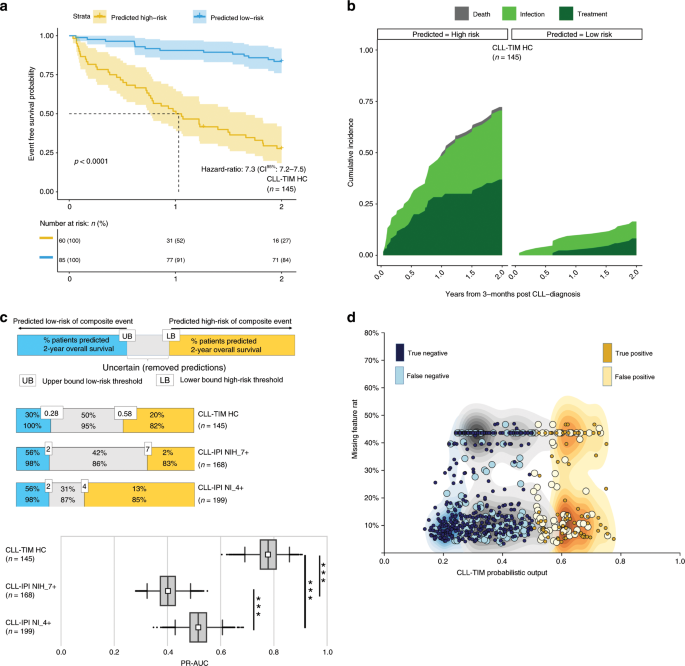
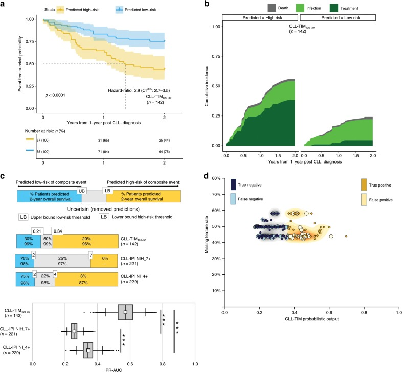
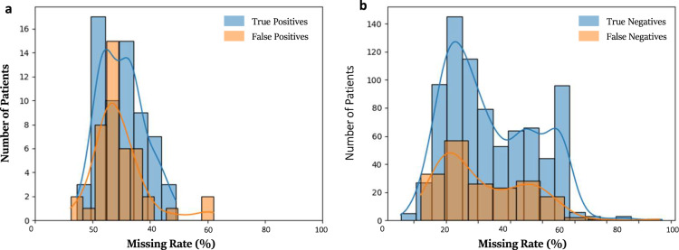

# Evidence and clinical application

[Overview](../README.md) · [Using CLL-TIM](USAGE.md) · [Methods](METHODS.md) · [Implementation](IMPLEMENTATION.md)

## Outcome and prediction point

CLL-TIM was developed to identify newly diagnosed patients at risk of the composite outcome of infection and/or CLL treatment within two years of a prediction point. For development, that point was three months after diagnosis; patients treated or deceased before it were excluded. Prediction timing varied in the internal and external test cohorts, as detailed in the original paper and supplement.

The original infection proxy was a blood-culture draw regardless of whether the culture was positive, negative or contaminated. This is distinct from all infections, culture-confirmed infections, and the CTCAE grade >=3 infection endpoint used in later prospective trial follow-up.

## Original development and validation · 2020

The Danish registry population contained 4,149 patients. After prediction-point exclusions, 3,720 remained: 2,432 for training, 642 for validation and 646 for the held-out internal test cohort.

The frequently quoted **72% precision and 75% recall** concern high-confidence predictions in the internal benchmark comparison: **145 high-confidence predictions among 288 patients** with complete CLL-IPI and two-year follow-up (BENCH-I). These numbers are not overall accuracy or performance estimates for every patient identified in the registry.

The model was also evaluated externally in the German CLL7 cohort. The comparison subset (BENCH-E) comprised **281 patients with complete CLL-IPI and two-year follow-up**, of whom 142 were selected using T20–30: the top 20% high-risk and bottom 30% low-risk predictions. Despite substantial missing longitudinal CLL-TIM features, selected high- and low-risk groups showed different outcomes. This comparison does not show that CLL-IPI was unavailable for most of those patients.

[Original paper](https://doi.org/10.1038/s41467-019-14225-8) · [Local PDF](papers/Agius2020_NatCommun_CLLTIM.pdf) · [Supplement](papers/Agius2020_NatCommun_CLLTIM_Supplementary.pdf)

### Internal benchmark

*Agius et al., Nature Communications (2020), Figure 3. Panels a–c use BENCH-I (n=288; n=145 high-confidence predictions); panel d uses the internal test cohort (n=646). The figure includes the selection rules and uncertainty. See the source caption for panel-specific analysis.*

### German external comparison

*Agius et al., Nature Communications (2020), Figure 4. The external benchmark comparison uses BENCH-E (n=281; n=142 T20–30-selected predictions). The lack of longitudinal features is distinct from the availability of the CLL-IPI variables required for that comparison.*

## EHR deployment · 2024

The deployment study describes a standalone service adjoining an Epic-based Danish EHR. Automated extraction, data harmonization, scoring and return of results made the model's outputs available in the patient context. Deployment evaluation used patients from **Rigshospitalet and Roskilde**.

The post-2018 population-based deployment cohort contained **1,480 patients**; the analyzed deployment benchmark contained **1,099**. Key variables were unexpectedly often unavailable in structured form. This makes it essential to distinguish the full cohort from selected benchmark subsets and to report high-confidence coverage with performance.

On Bench-B (n=1,099), about 25% of predictions were high confidence. The paper reports MCC 0.500 for high-confidence predictions versus 0.289 when including all predictions. It also explores a higher high-risk threshold of 0.65; the authors state that this adjustment needs assessment on a new patient set. The supplied mobile application retains 0.58.

The paper reports that CLL-IPI could be calculated for only 7/1,099 patients in the deployment benchmark under those missing-data conditions. That result belongs to this Danish deployment analysis, not the 2020 German comparison.

Predictions in the EHR were labeled **research-use only**. System-wide population coverage is not the number of CLL patients scored or clinically validated.

[Deployment paper](https://doi.org/10.1038/s41746-024-01132-6) · [Open full text](https://pmc.ncbi.nlm.nih.gov/articles/PMC11153589/) · [Local PDF](papers/Agius2024_npjDigitMed_CLLTIM_deployment.pdf)

### Missingness among correct and incorrect predictions

*Agius et al., npj Digital Medicine (2024), Figure 7; Bench-C (n=1,099). The missingness distributions are similar for correct and incorrect predictions. This is not an accuracy-versus-missingness curve. The paper also identifies susceptibility to missing key variables, including Binet stage.*

## Trial selection · PreVent-ACaLL

CLL-TIM has been used to identify high-risk/high-confidence participants for PreVent-ACaLL, an international randomized trial comparing pre-emptive treatment with observation. Trial selection, predictive validation and evidence that an intervention improves outcomes are different questions.

The registry record lists seven sites in Denmark, Sweden and the Netherlands in its December 2023 update. The later EHA abstract describes nine sites. Site counts and recruitment status should be attributed to their dated sources.

[Trial record: NCT03868722](https://clinicaltrials.gov/study/NCT03868722)

## Prospective follow-up · EHA 2026

**Conference abstract S143.** Nine sites assessed 574 patients. Of 95 high-risk/high-confidence patients, 40 entered the randomized trial component; the reported non-randomized high-risk/high-confidence outcomes concern the remaining 55. Their reported two-year infection-/treatment-free estimate was 54%. The endpoint uses CTCAE grade >=3 infection, not the original blood-culture proxy. This is prospective prediction evidence, not a randomized treatment-effect result.

[EHA primary abstract](https://library.ehaweb.org/eha/2026/eha-2026/4206697/carsten.utoft.niemann.prospective.validation.of.the.cll-tim.machine-learning.html). The indexed primary-source text was checked in November 2026; direct page access was intermittent.

## US external evaluation · AACR 2026

**Conference abstract 4228.** In 454 Rochester Epidemiology Project patients, composite ROC-AUC was 0.74 (95% CI 0.68–0.80), versus 0.69 for CLL-IPI (p=0.11) and 0.68 for IPS-E (p=0.02). Infection-only AUC was 0.68; the authors attribute most discrimination to treatment prediction. Equal rounded AUCs across studies do not establish identical performance or calibrated individual probabilities.

[Abstract DOI](https://doi.org/10.1158/1538-7445.am2026-4228) · [Official AACR proceedings, abstract 4228](https://www.aacr.org/wp-content/uploads/2026/04/AACR2026_Proceedings_Part-1.pdf)

## Publications

- **Model:** Agius R., et al. *Machine learning can identify newly diagnosed patients with CLL at high risk of infection.* Nature Communications 11, 363 (2020). [DOI](https://doi.org/10.1038/s41467-019-14225-8).
- **Deployment:** Agius R., et al. *Deployment and validation of the CLL treatment infection model adjoined to an EHR system.* npj Digital Medicine 7, 147 (2024). [DOI](https://doi.org/10.1038/s41746-024-01132-6).
- **Recommendations:** Agius R., et al. *Artificial intelligence models in chronic lymphocytic leukemia—recommendations toward state-of-the-art.* Leukemia & Lymphoma 63, 265–278 (2022). [DOI](https://doi.org/10.1080/10428194.2021.1973672).
- **Prospective follow-up:** EHA Congress 2026, S143, linked above.
- **US evaluation:** Mwangi R., et al. Cancer Research 86(7 Supplement), abstract 4228 (AACR 2026), linked above.

Publication figures reproduced here are © the original authors, under [CC BY 4.0](https://creativecommons.org/licenses/by/4.0/). They have not been analytically redrawn. See the [figure-source register](figures/SOURCES.md) for identities and attribution.
