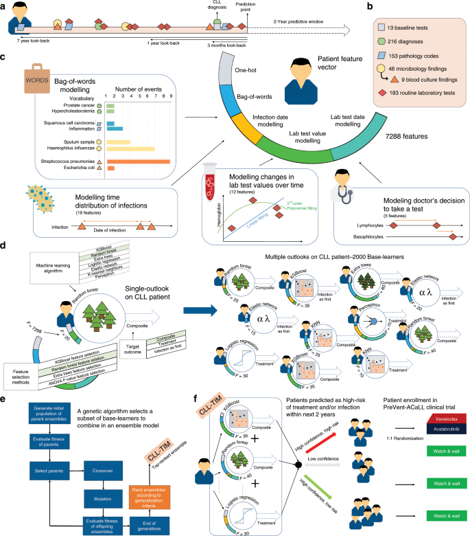
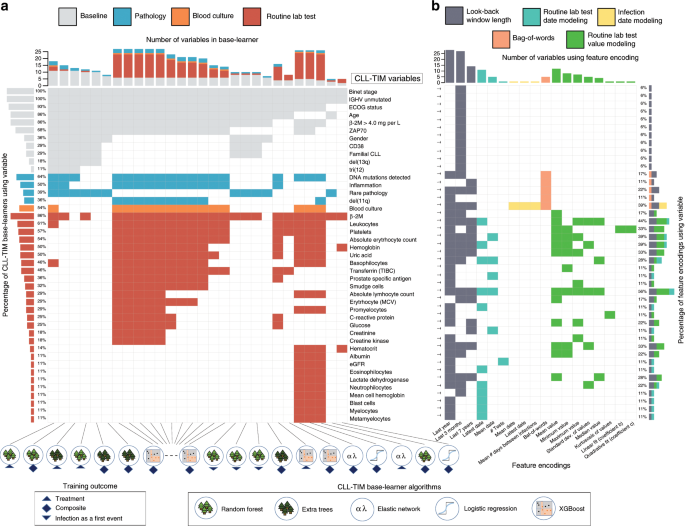
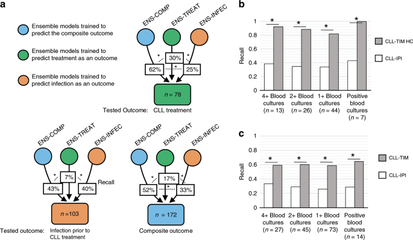
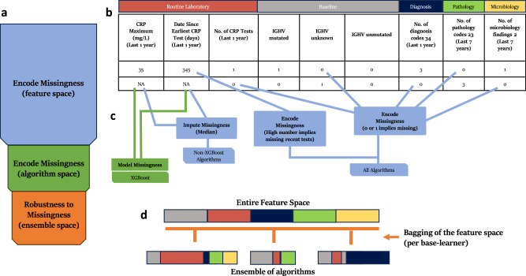
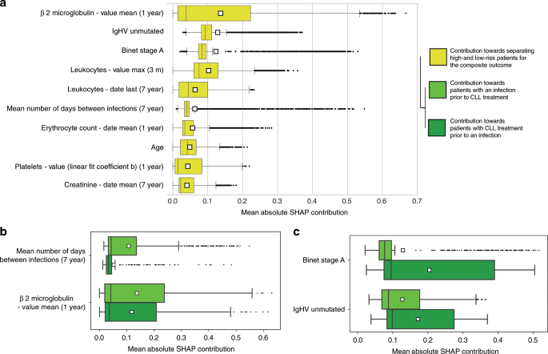
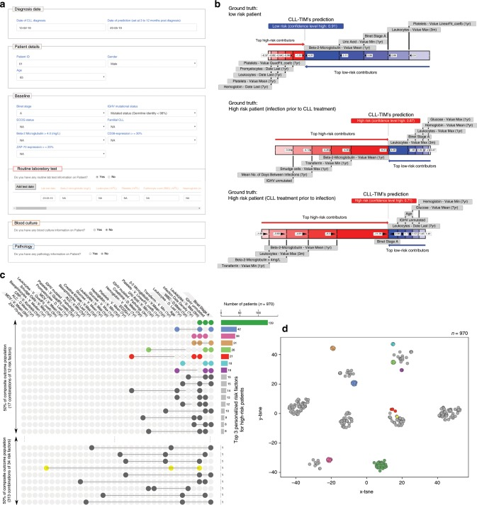

# Model and methods

[Overview](../README.md) · [Using CLL-TIM](USAGE.md) · [Evidence](EVIDENCE.md) · [Implementation](IMPLEMENTATION.md)

## Combining different views of patient history

CLL-TIM combines 28 learners selected to provide different views of heterogeneous clinical data. The development process varied algorithms, hyperparameters, feature subsets and target outcomes. Diversity was a design objective; it is not a guarantee that all learner errors are independent.

The original feature search spanned **7,288 features**. The selected ensemble uses **84 variables encoded into 228 features**, including summaries over three-month, one-year and seven-year look-back windows. A variable such as a laboratory measurement can produce several features: its minimum value, mean, trend, variability, or time since the last test.

*Agius et al., Nature Communications (2020), Figure 1. Overview of development and the intended PreVent-ACaLL selection pathway; this is not an inference-time architecture diagram.*

## Selecting the ensemble

The development protocol generated 2,000 candidate learners across seven algorithm families. Of these, 1,000 targeted the composite outcome, 500 treatment and 500 infection as a first event. Learners below their respective population-mean cross-validation MCC were filtered before ensemble selection.

A genetic algorithm generated 29 ensembles containing 2–30 learners. Ranking used six criteria combining performance and diversity considerations. The top-ranked ensemble was then evaluated on held-out cohorts. The supplied repository contains the fitted ensemble, not the complete executable training and selection workflow.

| Selected learner family | Count |
|---|---|
| XGBoost | 13 |
| Random Forest | 7 |
| Extra Trees | 4 |
| Elastic-net linear classifier (`SGDClassifier`) | 2 |
| Logistic Regression | 2 |

Twenty learners target the composite outcome, five treatment and three infection as a first event.

*Agius et al., Nature Communications (2020), Figure 2. Variables and encodings used by the selected ensemble, with algorithm families and training outcomes. The visualization condenses the variable set; see the paper and Supplementary Data 1 for full details.*

## Scoring in the supplied mobile implementation

The application constructs a 228-feature vector. Each learner takes its own subset. Non-XGBoost learners use stored imputation values and fitted scalers; XGBoost accepts missing values internally. The application averages probability column 1 from all 28 learners:

$$s = \frac{1}{28}\sum_{i=1}^{28} f_i(\mathbf{x}_i).$$

It rounds this mean to two decimals before assigning report categories. The stored min/max arrays normalize feature values for parts of the report; they do **not** normalize learner probabilities before averaging.

*Synthetic demonstration generated by [clltim_showcase.py](../examples/clltim_showcase.py). Dots show individual learner outputs, black vertical marks show their means, and horizontal bars show one standard deviation. The confidence label uses the rounded mean; the standard deviation is not used to assign it. This chart provides no clinical performance estimate.*

## Confidence

The mean score is used as a confidence proxy: values nearer the extremes are treated as more confident. The supplied implementation labels scores below 0.28 or at least 0.58 high confidence. Scores between those boundaries are low confidence; it still emits a score for them.

The original thresholds were selected on a validation cohort to meet trial-selection requirements: approximately 20% high-risk/high-confidence and 30% low-risk/high-confidence predictions. Fixed thresholds do not guarantee those proportions in a different cohort. The German external comparison used cohort-specific T20–30 selection. The 2024 paper also explores a higher high-risk threshold; see [evidence](EVIDENCE.md).

Confidence is not separately calculated from the variance of the votes. The reported hazard ratios describe separation between outcome groups; their ratio is not an accuracy multiplier.

## Why infection and treatment were modeled together

*Agius et al., Nature Communications (2020), Figure 6. Panel a compares average recall across ensembles trained on infection, treatment or the composite outcome, on n=530 internal-test patients with full two-year follow-up. Panels b–c compare infection definitions and confidence selection in BENCH-I. This figure does not plot performance against ensemble size.*

## Missing data

The published approach handles missingness at three levels: features can encode unavailable measurements or test timing; learners can handle missing values internally or through imputation; and feature subsets distribute dependence on individual variables across learners.

*Agius et al., npj Digital Medicine (2024), Figure 6. A conceptual explanation of missing-data handling, not an empirical performance curve. The deployment paper identifies particular sensitivity to missing key variables such as Binet stage.*

The mobile application processes baseline, laboratory and infection-indicator inputs, and fills unused pathology/diagnosis positions with zeros. It also assigns Binet A when no Binet category is encoded. These implementation choices should be distinguished from a general claim that any missing input is harmless.

## Contributing factors

The publications use SHAP to analyze population and patient-specific factors. Features visible in the published top-factor analysis include beta-2 microglobulin, IGHV, Binet stage, leukocyte measures and infection history.

*Agius et al., Nature Communications (2020), Figure 7. Analysis on the Danish research population (n=3,720), not a nine-patient synthetic summary.*

*Agius et al., Nature Communications (2020), Figure 9. Patient heterogeneity and the historical web interface; the image does not establish that the old web service is currently available.*

The supplied mobile report aggregates SHAP outputs with differing class directions and scales. Its explanation implementation requires separate validation; it is not presented as an additive decomposition of the ensemble probability. See [implementation findings](IMPLEMENTATION.md#feature-explanations).

Methods and figure captions are grounded in the [2020 paper and supplement](EVIDENCE.md#original-development-and-validation--2020) and [2024 deployment paper](EVIDENCE.md#ehr-deployment--2024). Publication figures are © the original authors under [CC BY 4.0](https://creativecommons.org/licenses/by/4.0/); [full figure register](figures/SOURCES.md).
