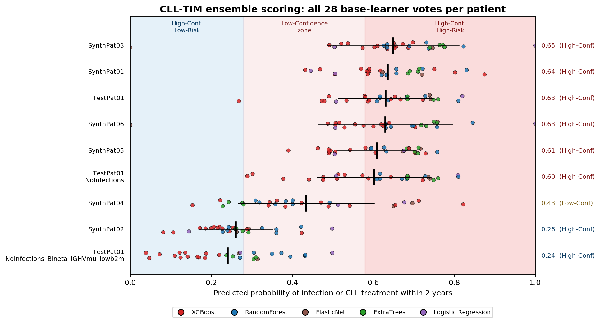

# Model and methods

[Overview](../README.md) · [Using CLL-TIM](USAGE.md) · [Validation](EVIDENCE.md) · [Technical reference](IMPLEMENTATION.md)

## Modeling patient history

We developed CLL-TIM to predict the two-year composite outcome of infection and/or CLL treatment using multiple perspectives on a patient's clinical history. We combined baseline CLL prognostic markers with longitudinal laboratory results, infection histories and other routinely collected clinical data.

During development, we constructed **7,288 features** and selected an ensemble using **84 variables represented by 228 features**. We modeled three-month, one-year and seven-year histories. For a laboratory variable, different features can represent its mean, minimum, variability, rate of change, number of tests or time since the last test.

*Our 2020 Figure 1: development of CLL-TIM and the clinical-trial selection pathway.*

## Developing the ensemble

We generated 2,000 candidate base-learners with different algorithm families, hyperparameters, feature subsets and target outcomes. Of these, 1,000 modeled the composite outcome, 500 CLL treatment and 500 infection as a first event. We used seven algorithm families spanning linear and nonlinear decision boundaries, and filtered out learners below their respective population-mean cross-validation MCC before ensemble selection.

We then used a genetic algorithm to generate 29 ensembles containing 2–30 learners. We ranked these ensembles using six performance and diversity criteria and selected the highest-ranked ensemble as CLL-TIM. We evaluated the selected model on held-out internal and external cohorts.

| Algorithm family in CLL-TIM | Number of learners |
|---|---|
| XGBoost | 13 |
| Random Forest | 7 |
| Extra Trees | 4 |
| Elastic-net linear classifier | 2 |
| Logistic Regression | 2 |

The final ensemble contains 20 learners modeling the composite outcome, five modeling CLL treatment and three modeling infection as a first event. Feature subsets provide different views of the available clinical history.

*Our 2020 Figure 2: algorithm families, target outcomes, variables and feature encodings. The figure presents a condensed view of the variables; the complete feature set is described in Supplementary Data 1.*

## Predicting infection and CLL treatment

For a patient, CLL-TIM constructs a 228-feature vector and passes the relevant subset to each learner. Non-XGBoost learners use fitted imputation values and scalers; XGBoost handles missing values internally. We combine the learners using soft voting:

$$s = \frac{1}{28}\sum_{i=1}^{28} f_i(\mathbf{x}_i),$$

where each learner returns a class-1 probability. The scoring script rounds the combined prediction to two decimals for reporting. Stored min/max arrays are used for feature displays; the probabilities are averaged directly.

*Synthetic patient illustration. Dots show individual learner predictions, vertical marks show their means and horizontal bars show one standard deviation. Predictive confidence is assigned from the rounded mean. [Generate this figure](../examples/clltim_showcase.py).*

## Predictive confidence

We designed CLL-TIM to accompany each risk prediction with an estimate of predictive confidence, calculated without knowledge of the patient's outcome. We use the mean probabilistic prediction as a confidence proxy: predictions closer to the extremes indicate greater certainty, while predictions closer to the decision boundary indicate greater uncertainty.

During development, we selected thresholds on the validation cohort to identify approximately 20% of patients as high risk with high confidence and 30% as low risk with high confidence. The scoring script uses **≥0.58 for high-risk/high-confidence** and **<0.28 for low-risk/high-confidence** predictions. The proportion classified with high confidence depends on the cohort. In the external German comparison, we selected the corresponding top 20% high-risk and bottom 30% low-risk predictions using T20–30.

We found stronger separation of high- and low-risk outcomes among high-confidence predictions. Our prospective PreVent-ACaLL results also supported predictive confidence: high-risk/high-confidence patients had worse outcomes than high-risk/low-confidence patients. See [validation](EVIDENCE.md).

## Why we modeled infection and treatment together

We modeled the composite outcome to capture both infectious complications and CLL progression leading to treatment. We compared ensembles trained on infection, treatment or the composite outcome, and examined their ability to detect each outcome.

*Our 2020 Figure 6. Panel a compares average recall across ensembles in n=530 internal-test patients with full two-year follow-up. Panels b–c compare infection definitions and confidence selection in BENCH-I.*

## Handling missing data

We addressed missingness at three levels:

- **Feature level:** representations of missing measurements, test frequency and test timing allow missingness to carry information.
- **Algorithm level:** XGBoost handles missing values internally; other learners use fitted imputation.
- **Ensemble level:** feature subsets distribute dependence on individual variables across learners.

*Our 2024 Figure 6: missing-data representations, imputation/internal handling and feature bagging.*

In the EHR deployment, we found CLL-TIM could provide predictions despite substantial missingness, while missing key variables such as Binet stage affected performance. The scoring script reads baseline markers, laboratory results and infection indicators. It fills pathology/diagnosis positions internally and assigns Binet A when no Binet category is encoded. [Technical reference](IMPLEMENTATION.md).

## Personalized risk factors

We use SHAP to identify the factors contributing to each patient's predicted risk. We rank the factors pushing towards higher risk and those pushing towards lower risk, providing an explanation specific to the patient's combination of clinical findings and history.

At a population level, we identified risk factors including beta-2 microglobulin, IGHV mutational status, Binet stage, leukocyte measures and previous infections. Their contributions are nonlinear and depend on the other information available for a patient. Two patients with similar predicted risk may therefore have different personalized risk factors.

*Our 2020 Figure 7: population-level risk-factor analysis in 3,720 Danish patients.*

*Our 2020 Figure 9: the original web interface and patient-specific risk-factor patterns.*

The [technical reference](IMPLEMENTATION.md#personalized-risk-factors) documents the SHAP class and output-scale conventions in the scoring script.

## Sources

Our [2020 model publication and supplement](EVIDENCE.md#publications) describe feature generation, model selection, confidence and personalized risk factors. Our [2024 deployment publication](EVIDENCE.md#ehr-deployment-and-validation--2024) describes data harmonization, missingness, automation and EHR monitoring.

Publication figures: © the original authors, [CC BY 4.0](https://creativecommons.org/licenses/by/4.0/). [Figure sources and attribution](figures/SOURCES.md).
